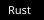
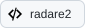
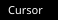

# Tech Stack

**Languages**

**Web & Frameworks**

**Infrastructure & DevOps**

**Cloud & Edge**

**Databases**

**Vector Databases & RAG**

**LLM Inference & Serving**

**AI/ML Frameworks**

**Computer Vision**

**HPC & GPU Computing**

**Architecture & Low-Level**

**Security & Networking**

**Message Queues & Streaming**

**Tools & Editors**

